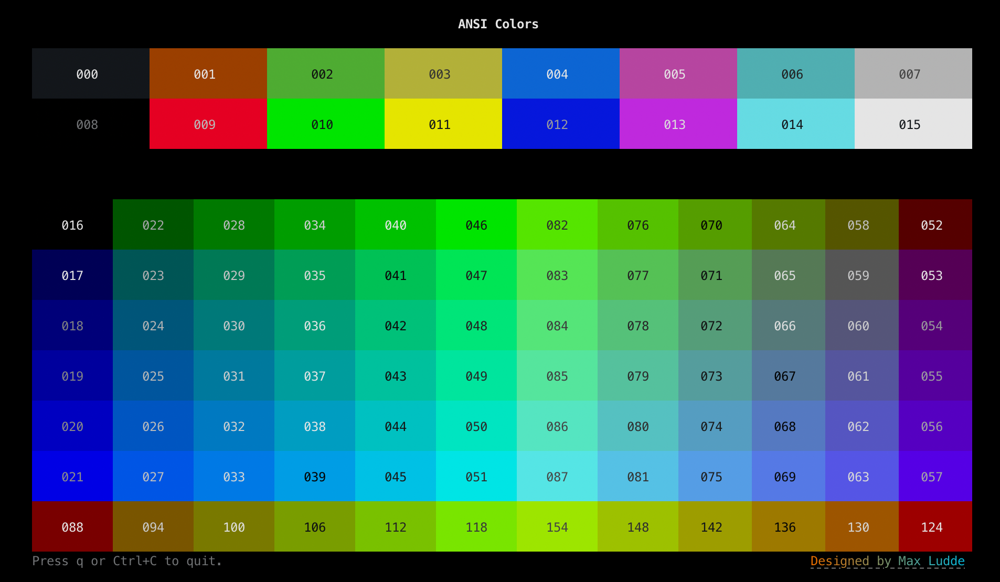
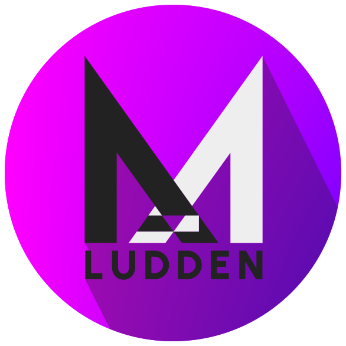

# AnsiCube

An interactive ANSI 256-color explorer for the terminal.

📖 **Documentation and screenshots:** <https://maxludden.github.io/ansiCube/> · [Changelog](CHANGELOG.md)

AnsiCube renders system colors, the full 6×6×6 color cube, and grayscale ramps as clickable tiles that automatically adapt to your terminal size. Click any color to copy its ANSI color code directly to the clipboard, with instant visual feedback. It supports mouse and keyboard navigation, dynamic resizing, and high-contrast labels for readability. Built with [Bubble Tea v2](https://github.com/charmbracelet/bubbletea) and [Lip Gloss v2](https://github.com/charmbracelet/lipgloss).

## Features

- Click any tile to copy its ANSI color number to the clipboard
- Falls back to the OSC 52 terminal clipboard when no native clipboard is available (e.g. over SSH)
- Responsive layout with mouse-wheel and keyboard scrolling
- Tile labels use whichever of black or white text has the higher WCAG contrast

## Install

### Homebrew

```bash
brew install maxludden/tap/ansicube
```

### Go install

```bash
go install github.com/maxludden/ansiCube@latest
```

Note: `go install` names the binary after the module path, so it is installed as `ansiCube`.

### Binary release

Download a prebuilt binary from the GitHub Releases page.

## Usage

```bash
ansicube            # launch the explorer
ansicube --version  # print the version
```

If you installed with `go install`, run `ansiCube` instead.

## Controls

| Input | Action |
| --- | --- |
| Left click | Copy the tile's color number |
| Mouse wheel, `↑`/`↓`, `j`/`k` | Scroll |
| `PgUp` / `PgDn` / `space` | Scroll one page |
| `Home` / `End` | Jump to top / bottom |
| `q` | Quit, after confirmation (`y`/`Enter` to confirm, `n`/`Esc` to cancel) |
| `Ctrl+C` | Quit immediately |

## Development

Requires Go 1.26 or newer.

```bash
make run     # go run .
make test    # go test -race ./...
make check   # tests, vet, golangci-lint and govulncheck
make build   # builds ./ansicube
make docs    # renders screenshots (needs vhs) and builds the docs site
```

## License

MIT

---


<div align="center">
    <p>Designed by Max Ludden</p>
    <br />
    
</div>
